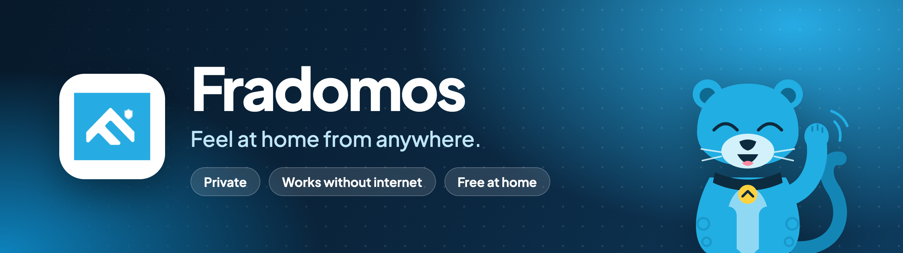
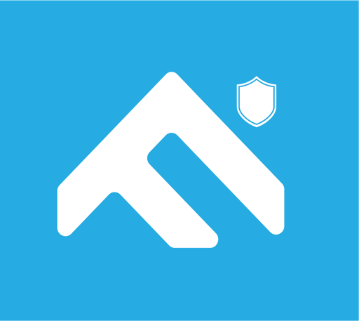

 

**[🌐 Website](https://fradomos.com)** &nbsp;·&nbsp; **[🛒 Shop](https://shop.fradomos.com)** &nbsp;·&nbsp; **[👤 My account](https://account.fradomos.com)** &nbsp;·&nbsp; **[📡 Remote](https://remote.fradomos.com)** &nbsp;·&nbsp; **[🏠 Studio](https://studio.fradomos.com)**

 

##  What is Fradomos?

A private smart home. One calm app for your whole house.

- 💡 Lights, air conditioning, gates
- 🛡️ Security, cameras, gas and door warnings
- ⚡ Energy and routines
- 🔒 Your data stays **in your home**
- 📶 Works **without internet**
- 🆓 **Free at home**, always. No ads.

 

## ✨ Services for you

| | Service | What you do there |
|---|---|---|
| 🏠 | **[Fradomos Studio](https://studio.fradomos.com)** | • Design your home in 3D • Draw rooms, floors, stairs and roofs • Place lights, devices and furniture • Walk through it before you build |
| 📡 | **[Fradomos Remote](https://remote.fradomos.com)** | • Open your home from anywhere • Switch lights, run routines • See cameras, energy and alerts • Manage your plan and billing |
| 👤 | **[Account Center](https://account.fradomos.com)** | • One account for all your homes • Your profile and security • Your homes and who may connect |
| 🛒 | **[Fradomos Shop](https://shop.fradomos.com)** | • Order Fradomos products • Track your orders • Write reviews |
| 🌐 | **[fradomos.com](https://fradomos.com)** | • Learn how it works • Help articles and news • Pricing and contact |
| 📱 | **Phone app** | • Control your home at home and away • Floor plan, routines, music, guests |
| 📺 | **TV app** | • Your home on the big screen • Pair it with your phone by QR code |
| 🖥️ | **Home dashboard** | • Set up and run your home, even offline • Rooms, devices, people, energy |

 

## 🔌 What we make

- 🔘 **Circuit boards** for lights and appliances &nbsp;`Available`
- 🌡️ **Temperature & gas sensor** &nbsp;`Available`
- 🖼️ **Wall screen** &nbsp;`Available`
- 🎛️ **Fradomos Beam** for air conditioners and TVs &nbsp;`New`
- 🔔 **Intercom** &nbsp;`New`
- 🎙️ **Voice button** &nbsp;`Coming soon`
- 🔊 **Fraddo speaker** &nbsp;`Coming soon`

 

## 👤 Who founded it?

- **[Endri Ndoja](https://encodex.dev)** founded Fradomos ([LinkedIn](https://www.linkedin.com/in/endri-ndoja-b10664339/))
- Goal: **safer smart homes** and an **easier life**

 

## 📖 Our story

- **2024** – a project: lights switched with hardware and a phone
- **2025** – the local system. Data stays at home. A diploma project at HTL "Peter Mahringer", Shkodër
- **Oct 2025** – 🥇 **first place at Youth Start**
- **2026** – air conditioning, sensors, gates, wall screen, intercom
- **Oct 2026** – the redesign: safer, simpler, better

 

## 🗺️ The plan

**Now**
- 🔐 A safer Fradomos
- ✨ A calmer, faster experience everywhere
- 👤 One account for every home

**Next**
- 🚪 Motion and light sensors
- ⚙️ Routines that start from a sensor
- 🎙️ Voice button and Fraddo speaker
- 🏠 More tools to design your home

**Always**
- 🆓 Free at home
- 🔒 Your data stays yours
- 🤝 Honest about what works today

 

## 💬 Contact

- 🌐 [fradomos.com](https://fradomos.com)
- 📸 [Instagram](https://www.instagram.com/fradomos) · 💼 [LinkedIn](https://www.linkedin.com/company/fradomos) · 👍 [Facebook](https://www.facebook.com/people/Fradomos/61574066033484/)

© Fradomos · Feel at home from anywhere

